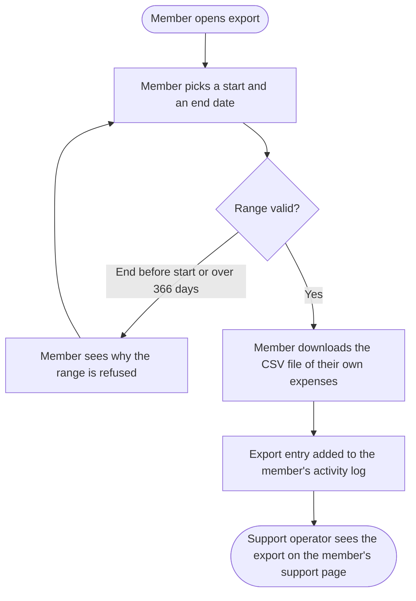

# Expense reports: Specification

## Purpose

Members of the expense app keep their records in the app but file their taxes in a spreadsheet. They need to get their expenses out of the app in a form a spreadsheet opens directly, without retyping them, and usually for one tax year. Support needs to be able to tell when a member exported their data.

## Scope

- In scope: Expense export, Tax-year selection.
- Non-goals: exporting other members' expenses (R3); scheduled exports (product owner, message 5); Excel `.xlsx` files, rejected in favor of CSV (D1).

Deferred:

- PDF reports: not for the first release; next: revisit once CSV export is in use (product owner, message 6).

## Actors

| Actor | Kind | Description | Authority |
| --- | --- | --- | --- |
| Member | user | A signed-in person who records their own expenses and wants them in a spreadsheet. | Exports their own expenses only. |
| Support operator | operator | A staff member who answers members' support requests and looks into reported data leaks. | Observes a member's activity log; cannot export a member's expenses. |

## Terms

**Expense**: one recorded spending, with a date, an amount, a currency, a category and an optional note.
**Activity log**: the list of a member's actions that support operators see on the member's support page (the conversation calls it "the history").

## Requirements

| ID | Requirement | Feature | Source |
| --- | --- | --- | --- |
| R1 | "Members need to download their expenses so they can open them in Excel or Google Sheets." | Expense export | Product owner, message 1 |
| R2 | "They pick the period." | Expense export | Product owner, message 3 |
| R3 | "Nobody should ever be able to get someone else's expenses." | Expense export | Product owner, message 4 |
| R4 | "Support has to see when someone exported, in case they report a leak." | Expense export | Support lead, message 9 |
| R5 | "Usually it's a tax year, so let them just pick the year." | Tax-year selection | Product owner, message 3 |

## Decisions

- D1: The export file is CSV only; `.xlsx` was considered and rejected (product owner and developer, message 6).
- D2: A date range covers at most 366 days (developer, message 7, agreed by the product owner in message 8).

## Facts

- F1: A visitor who is not signed in and opens any page of the app is sent to the sign-in page, and returns to the page they asked for after signing in (`src/middleware/requireSession.ts:14`).
- F2: Every date in the app is shown as `YYYY-MM-DD` in the member's time zone (`src/lib/formatDate.ts:8`).
- F3: A support operator sees a member's activity log on the member's support page, newest entry first, each entry with its time and a one-line description (`src/support/ActivityLog.tsx:22`).

## Feature: Expense export

Lets a member download their own expenses for a date range as a spreadsheet file, and lets a support operator see afterwards that the export happened.

- **Work type**: new behavior
- **Actors**: Member, Support operator
- **Requirements**: R1, R2, R3, R4

### Journey

| Step | Actor | Action or event | Visible result | Spec |
| --- | --- | --- | --- | --- |
| 1 | Member | Picks a start and an end date and asks for the export | The CSV file downloads, or a message says why the range is refused | S1 |
| 2 | Member | Opens the downloaded file in a spreadsheet | Their own expenses in the range, one per row, and nobody else's | S1, S2 |
| 3 | Support operator | Opens the member's support page | One activity log entry per downloaded export, newest first | S3 |

#### Diagram: Expense export journey

### S1. Member exports their expenses for a date range

- **Actor**: Member
- **Status**: Required
- **Traces to**: R1, R2, D1, D2
- **Preconditions**: The member is signed in.
- **Trigger**: The member chooses a start date and an end date and asks for the export.
- **Outcome**: The member's browser downloads a CSV file that contains every expense of that member dated from the start date to the end date, both included.

**Alternative and failure paths**

- The range has no expenses: [Q2]
- The end date is before the start date: no file is downloaded, and the member sees the message `The end date must be on or after the start date.` The member can change the dates and export again.
- The range covers more than 366 days: no file is downloaded, and the member sees a message that names the 366-day limit [Q3]. The member can change the dates and export again.

**Acceptance criteria**

1. Given a member with expenses dated 2025-01-01, 2025-06-30 and 2026-01-01, when they export 2025-01-01 to 2025-12-31, then the file contains exactly the two expenses dated 2025-01-01 and 2025-06-30.
2. Given the downloaded file, when it is opened in Excel and in Google Sheets, then each expense is one row, and its date, amount, currency, category and note are each in their own column. [Q1]
3. Given an expense whose note is `Lunch, with "client"`, when it is exported and the file is opened in a spreadsheet, then the note cell reads `Lunch, with "client"`.
4. Given a range of exactly 366 days, when the member exports it, then the file is downloaded.
5. Given a range of 367 days, when the member exports it, then no file is downloaded and the limit message is shown.
6. Given a start date of 2025-12-31 and an end date of 2025-01-01, when the member exports, then no file is downloaded and the message `The end date must be on or after the start date.` is shown.

### S2. Member cannot export another member's expenses

- **Actor**: Member
- **Status**: Required
- **Traces to**: R3, F1
- **Preconditions**: Two members, A and B, each have expenses in the same date range.
- **Trigger**: Member A exports that date range.
- **Outcome**: The file contains member A's expenses and none of member B's.

**Acceptance criteria**

1. Given members A and B each with one expense dated 2025-03-01, when member A exports 2025-03-01 to 2025-03-01, then the file contains exactly one expense, and it is member A's.
2. Given a visitor who is not signed in, when they request an export, then no file is downloaded and the visitor is sent to the sign-in page.

### S3. Support operator sees a member's exports in the activity log

- **Actor**: Support operator
- **Status**: Required
- **Traces to**: R4, F3
- **Preconditions**: A member has downloaded an export (S1).
- **Trigger**: A support operator opens that member's support page.
- **Outcome**: The member's activity log shows one entry for each export, with the time of the download. [Q4]

**Alternative and failure paths**

- The export was refused (S1, invalid or too long range): no entry is added.

**Acceptance criteria**

1. Given a member who exported twice, at 09:00 and at 09:05, when a support operator opens the member's support page, then the activity log shows two export entries, the 09:05 one first.
2. Given a member whose export was refused because the range covered 367 days, when a support operator opens the member's support page, then the activity log shows no export entry for that attempt.

## Feature: Tax-year selection

Lets a member fill the export's date range by choosing a tax year instead of typing two dates.

- **Work type**: new behavior
- **Actors**: Member
- **Requirements**: R5

### S4. Member chooses a tax year for the export

- **Actor**: Member
- **Status**: Required
- **Traces to**: R5, D2
- **Preconditions**: The member is signed in and is about to export (S1).
- **Trigger**: The member chooses a tax year.
- **Outcome**: The start and end dates are set to the first and last day of that tax year [Q5], and the member can export that range as in S1.

**Acceptance criteria**

1. Given a member who chooses tax year 2025, when the dates are filled in, then they are the first and the last day of tax year 2025. [Q5]
2. Given a member who chose a tax year and then changes the end date, when they export, then the file covers the changed range.

## Open questions

### Q1. In which format must dates and amounts appear in the file?

- **Unclear**: The conversation says the file must open in Excel and Google Sheets, but not how dates and amounts are written, or whether amounts use a dot or a comma as the decimal separator. F2 covers dates shown on screen, not dates in an exported file.
- **Why it matters**: A spreadsheet in some locales reads `1.250` as one thousand two hundred fifty, so the same file can show different amounts to different members.
- **Options raised**: dates as `YYYY-MM-DD` in the member's time zone, as the app shows them (F2).
- **Blocks**: S1

### Q2. What does the member see when the range has no expenses?

- **Unclear**: The conversation does not cover an empty range.
- **Why it matters**: The empty-range path of S1 cannot be checked until it is known whether the member gets a file or a message.
- **Options raised**: none raised.
- **Blocks**: S1

### Q3. What is the exact wording of the range-limit message?

- **Unclear**: D2 sets the 366-day limit, but no message text was agreed.
- **Why it matters**: Criterion 5 of S1 cannot check the message until its text is fixed.
- **Options raised**: none raised.
- **Blocks**: S1

### Q4. What must an export entry in the activity log say?

- **Unclear**: R4 asks that support sees when someone exported. F3 gives every entry a time and a one-line description, but the conversation does not say what the description of an export is, or whether it names the date range.
- **Why it matters**: A support operator looking into a leak may need the range to know which expenses left the app; criterion 1 of S3 can only check the count and order of entries until this is settled.
- **Options raised**: none raised.
- **Blocks**: S3

### Q5. On which day does a tax year start?

- **Unclear**: R5 lets the member pick a tax year, but the conversation does not say whether a tax year is the calendar year or starts on another date, or whether it depends on the member's country.
- **Why it matters**: S4 cannot say which dates are filled in, and a tax year that does not start on 1 January spans two calendar years.
- **Options raised**: none raised.
- **Blocks**: S4
