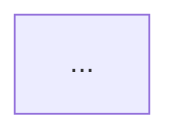
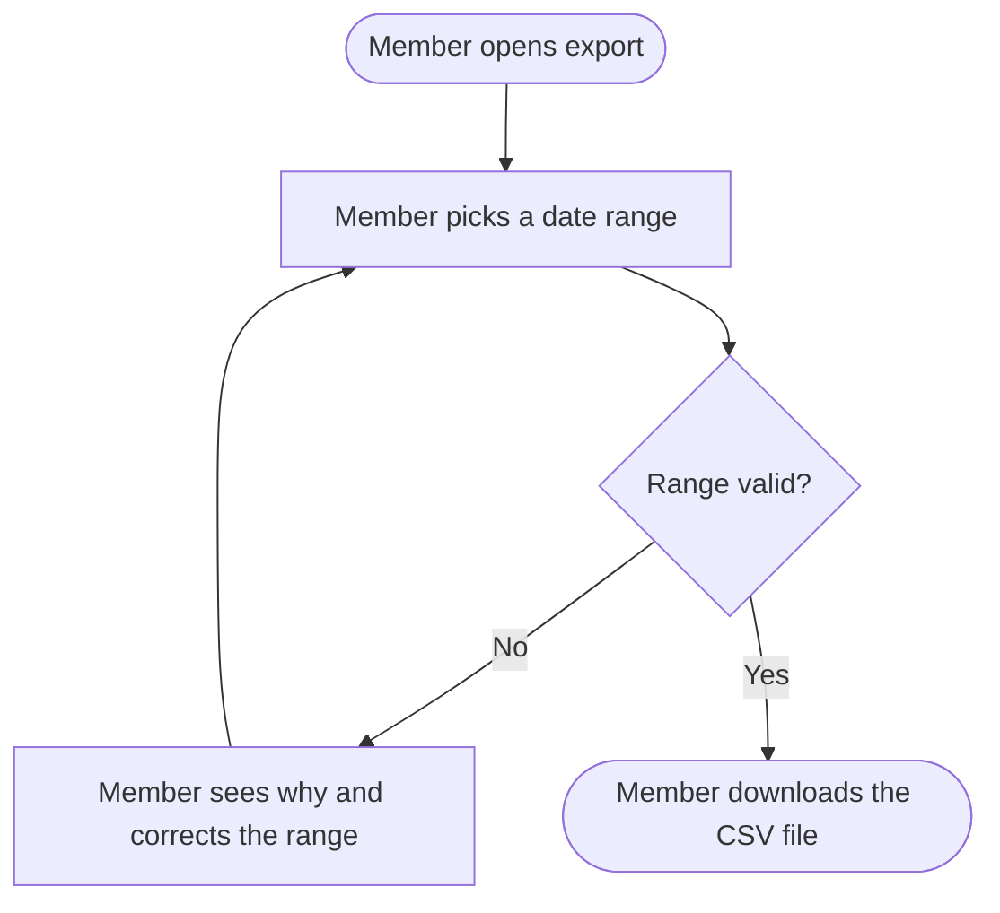
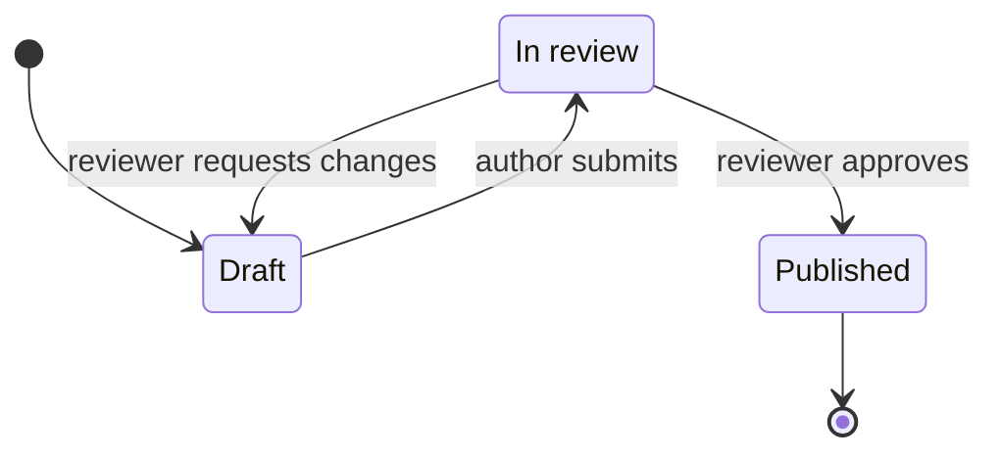
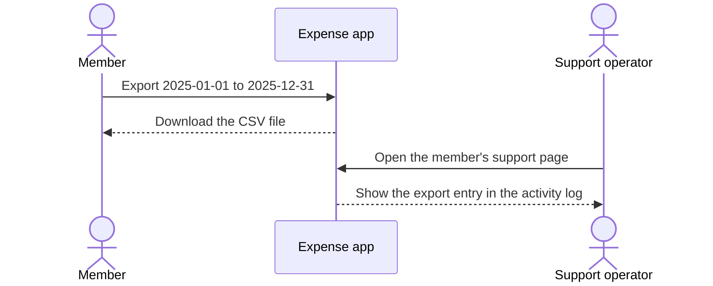

# Diagrams

Diagrams make a feature's journey, states, hand-offs and recovery easy to inspect. They never replace the tables and specifications: every node and arrow restates something a specification already says.

## Which diagrams a feature gets

| Diagram | When | Question it answers | Mermaid type |
| --- | --- | --- | --- |
| Journey | The feature has more than one specification | How do the actors get from the first trigger to the outcome? | `flowchart TD` |
| States | The feature has a States table | What state is the experience in, and what changes it? | `stateDiagram-v2` |
| Hand-offs | The order or timing between actors matters, such as one actor waiting for another's approval | Who passes what to whom, and in what order? | `sequenceDiagram` |
| Recovery | A failure path loops back (retry, correct, resubmit) in a way the journey diagram cannot show without becoming hard to read | What happens when an operation does not complete? | `flowchart TD` |

One diagram answers one question. When a journey has independent outcomes, draw one focused diagram per outcome rather than one large graph.

## Placement and captions

Place each diagram right after the table it draws, under a caption that names the feature and the question:

````markdown
#### Diagram: Expense export journey


````

The code block uses exactly the `mermaid` tag. Never nest a Mermaid block in another block, and never wrap the whole document in a code fence.

## Syntax

Use syntax that common Mermaid 10+ renderers support: plain text, simple shapes, explicit labels, no styling.

### Flowcharts

````markdown

````

- Use short, unique ASCII IDs such as `start`, `pick` and `file`, and put the readable text in the label.
- Use `[]` for an action or visible step, `{}` for a decision, and `([])` for a start or an end.
- Label every branch of a decision with the observable condition (`Yes`, `No`, `Retry`, `Approved`).
- One arrow is one meaningful transition. Split a node when the actor sees two separate results.

### State diagrams

````markdown

````

- Start with `[*]`, and end with `[*]` when the experience has a final state.
- Name states by what the actor observes, never by an internal flag such as `WorkerRunning`. Use an alias (`state "In review" as InReview`) for a name with spaces.
- Write the trigger after the colon on every transition.

### Sequence diagrams

````markdown

````

- Use `actor` for people and `participant` for the system or an external system as the actors see it, never an internal module.
- Write messages as actions, information or decisions, never as method names or protocol calls (`Export the range`, not `POST /exports`).
- Show the visible effect after each hand-off.

## Labels

- Use the same names for actors, states and specifications as the tables do.
- Write labels that say what an actor did, what the system showed, which condition caused a branch, or how the actor recovers. Prefer `Show missing fields` over `validate()`.
- Keep labels short. Avoid unescaped brackets, braces, quotes, colons and newlines in labels, and never put a pipe character in a branch label.
- Do not use color, line style or shape alone to carry meaning.

## Size

- Aim for 5 to 12 nodes per flowchart. Above about 15, split by journey stage, by actor or by recovery boundary.
- Do not drop a branch to make a diagram smaller; split the diagram instead.
- Use subgraphs only to group actors or journey stages, never technical layers.

## Checklist

1. Every node and arrow matches a row of the Journey or States table, or a path of a specification, and every branch in those appears in the diagram.
2. No diagram adds behavior, authority or an outcome that the specifications do not state, and no diagram settles an open question by choosing a path.
3. Every block opens with ` ```mermaid ` and a supported declaration (`flowchart TD`, `flowchart LR`, `stateDiagram-v2`, `sequenceDiagram`), and is closed.
4. Every diagram has a caption, and its IDs are unique within it.
5. Every decision branch is labeled, the journey has a start and an end, and the state diagram starts with `[*]`.
6. No label names a layer, component, endpoint or internal step.

If a Mermaid renderer is available, render every block and fix what fails. If not, run the checks above and do not report the diagrams as rendered.
